  

  

 

 

<table border="0" style="width: 100%;">
  <tr>
    <td width="48%" valign="top">

### 👨‍💻 Sobre Mim / About Me

> *"Automatizando processos e transformando dados brutos em estratégias acionáveis."*
> *"Automating processes and transforming raw data into actionable strategies."*

Sou estudante de **Ciência da Computação**, **Co-Fundador da QuadCode** e atuo como Engenheiro e Analista de Dados. Especialista na criação de soluções escaláveis — da arquitetura de dados (ETL, Scraping) ao desenvolvimento completo de plataformas SaaS.

I'm a **Computer Science** student, **Co-Founder of QuadCode**, working as a Data Engineer and Analyst. Specialist in building scalable solutions — from data architecture (ETL, Scraping) to full SaaS platform development.

- 🎓 **Formação / Education:** Ciência da Computação @ Estácio *(2027)*
- 🚀 **Foco / Focus:** Data Engineering, AI Integration & Business Automation
- 💼 **Projetos / Projects:** Clinical Telemonitoring, Civil Construction BI, Sports Analytics
- 💡 **Diferencial / Edge:** Deep native code knowledge + AI-accelerated prototyping

</td>
<td width="4%" valign="top"></td>
<td width="48%" valign="top">

### 🛠️ Tech Stack & Skills

**Languages**

**Databases & Data Engineering**

**Automation, Cloud & AI**

**Frontend & DevOps**

</td>
  </tr>
</table>

 

---

### 🏆 Projetos em Destaque / Featured Projects

<table border="0" style="width: 100%;">
  <tr>
    <td width="50%" valign="top">
      <h4>🩺 BioTrack SaaS</h4>
      

        Plataforma de telemonitoramento clínico com IA para análise preditiva e automação via API do WhatsApp. 
        <em>Clinical telemonitoring SaaS with AI for predictive analysis and WhatsApp API automation.</em>
      

      
      
      
        
      
    </td>
    <td width="50%" valign="top">
      <h4>✨ Patrícia Neri — Landing Page</h4>
      

        Landing page de alta conversão com foco em performance web, design responsivo e arquitetura limpa de front-end. 
        <em>High-conversion landing page focused on web performance, responsive design and clean front-end architecture.</em>
      

      
      
      
        
      
    </td>
  </tr>
  <tr>
    <td width="50%" valign="top">
      <h4>🏗️ Dashboard BI — INSS de Obras</h4>
      

        Automação e Business Intelligence para métricas de redução de impostos no setor de construção civil. 
        <em>Automation and Business Intelligence for tax reduction metrics in the civil construction sector.</em>
      

      
      
      
    </td>
    <td width="50%" valign="top">
      <h4>⚽ FutScore Analytics & Scout</h4>
      

        Pipeline de dados esportivos do Brasileirão com coleta automatizada (Scrapy) e análise avançada de desempenho. 
        <em>Brazilian football data pipeline with automated collection (Scrapy) and advanced performance analytics.</em>
      

      
      
      
    </td>
  </tr>
</table>

 

---

### 📊 GitHub Stats

  
  

  

  

 

---

### 🏅 GitHub Trophies

  

 

---

  <i>⚡ "O código que você não escreve nunca tem bugs." — talvez verdade, mas também nunca resolve nada.</i> 
  <i>⚡ "The code you don't write never has bugs." — maybe true, but it never solves anything either.</i>

